<p align="center">
  
</p>

<h1 align="center">BreezeOS</h1>

<p align="center">
  <b>Giao diện kính mờ hiện đại cho Windows 11 — nhẹ, mượt và thuần bản địa (Native Rust).</b><br>
  Deck · Visor · Thanh Rail · Quick Panel · Tìm kiếm nhanh · Scene · Tiện ích màn hình — chỉ khoảng ~15 MB RAM khi chạy nền.
</p>

<p align="center">
  <a href="https://github.com/thanhphong28/BreezeOS-win/releases"></a>
  
  
  
  
  
</p>

<p align="center">
  <a href="https://github.com/thanhphong28/BreezeOS-win/releases">Tải xuống</a> ·
  <a href="#-giới-thiệu-breezeos">Giới thiệu</a> ·
  <a href="#-thiết-kế-mô-đun">Mô-đun</a> ·
  <a href="#-cài-đặt">Cài đặt</a> ·
  <a href="#-hướng-dẫn-sử-dụng">Hướng dẫn</a> ·
  <a href="#-quyền-riêng-tư">Quyền riêng tư</a> ·
  <a href="#-công-nghệ-cốt-lõi">Công nghệ</a> ·
  <a href="#-build-từ-mã-nguồn">Build</a>
</p>

> [!WARNING]
> **Phiên bản Truy cập sớm (Early Access).** BreezeOS đang được phát triển tích cực bởi **Nguyễn Thanh Phong (Breeze Boy)**. Một số chi tiết giao diện hoặc thiết lập có thể thay đổi giữa các bản cập nhật. Nếu gặp lỗi hoặc có ý tưởng đóng góp, hãy gửi tại trang [Issues](https://github.com/thanhphong28/BreezeOS-win/issues). BreezeOS hỗ trợ cập nhật tự động ngay trong ứng dụng (*Cài đặt → Chung → Giới thiệu*).

> [!IMPORTANT]
> **Tuyên bố miễn trừ trách nhiệm.** BreezeOS là dự án độc lập, **không liên kết, không được tài trợ hay chứng nhận bởi Apple Inc. hoặc Microsoft Corporation**. BreezeOS sử dụng hệ thống tên gọi riêng (*Deck, Visor, Rail, Scene, Quick Search, Quick Panel, Crystal...*) và không chứa bất kỳ mã nguồn, biểu tượng, phông chữ hay tài nguyên độc quyền nào của bên thứ ba.

---

## ✨ Giới thiệu BreezeOS

**BreezeOS** khoác lên Windows 11 một không gian làm việc tinh gọn, hiện đại với chất liệu kính mờ (Frosted Glass & Crystal) cùng chuyển động đàn hồi mượt mà trên GPU:

- **Deck** — Thanh ứng dụng nổi với hiệu ứng phóng đại khi di chuột, xem trước cửa sổ trực tiếp (live preview), ngăn xếp Tải xuống và Thùng rác kính.
- **Visor & Viên nang (Capsule)** — Đảo thông tin tương tác ở cạnh trên màn hình: phát nhạc kèm lời bài hát đồng bộ thời gian thực, sóng nhạc & hiệu ứng cực quang theo bìa đĩa, theo dõi tiến trình tải xuống, kệ tệp kéo-thả, gửi tệp sang điện thoại qua mã QR, phiên tập trung (Pomodoro), công việc & lời nhắc, và nhắc lịch họp.
- **Thanh Rail** — Thanh menu phía trên cùng tích hợp logo BreezeOS, thực đơn ứng dụng thông minh (File, Edit, View...), trạng thái Wi‑Fi, pin, Tìm kiếm nhanh, Quick Panel và đồng hồ.
- **Bảng điều khiển nhanh (Quick Panel)** — Trung tâm điều khiển dạng kính cho phép kéo-thả sắp xếp và nắm góc co giãn kích thước từng ô điều khiển.
- **Tìm kiếm nhanh (Quick Search)**, **Scene**, **Tổng quan (Overview)**, **Lưới ứng dụng (App Grid)** và **Tiện ích màn hình (Widgets)**.

Toàn bộ chương trình là một tệp thực thi thuần bản địa duy nhất viết bằng **Rust**: không Electron, không WebView, không dịch vụ chạy ngầm nặng nề, không yêu cầu tài khoản. Khi ở trạng thái nghỉ, BreezeOS chỉ tiêu thụ khoảng **15 MB RAM**.

<p align="center">
  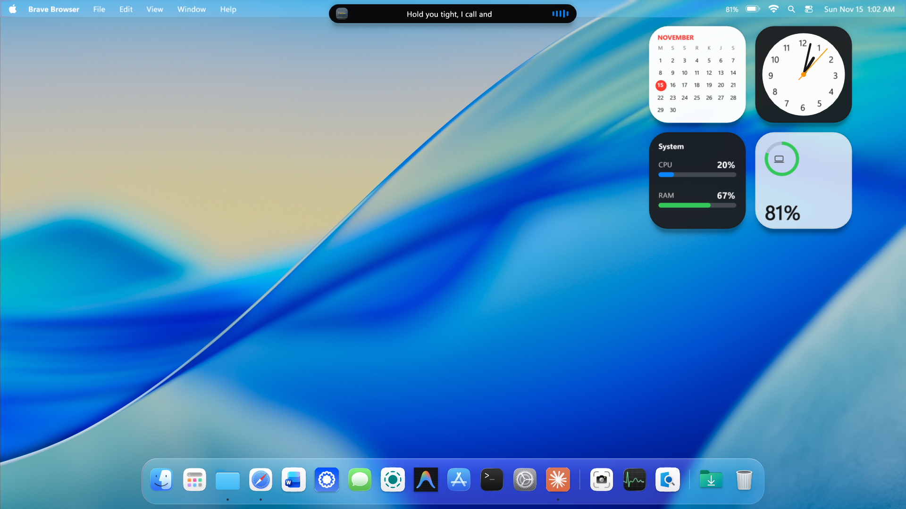
</p>

### 🌟 Điểm nổi bật trên phiên bản 1.0.1

- **Hỗ trợ trọn vẹn Tiếng Việt & Tiếng Anh**: Chuyển đổi tức thì tại *Cài đặt → Chung → Ngôn ngữ*. Toàn bộ giao diện, lịch, thứ/ngày/tháng, phiên tập trung, menu thanh Rail và trang gửi tệp sang điện thoại đều được bản địa hóa tự nhiên.
- **Hỗ trợ đa màn hình thông minh**: Tùy chọn màn hình hiển thị riêng cho Deck, Rail, Visor và Tiện ích (*Màn hình chính*, *Màn hình 1*, *Màn hình 2*...) với tỷ lệ DPI độc lập trên từng màn hình; tự động thu về màn hình chính khi rút cáp và khôi phục khi cắm lại.
- **Mẫu thiết lập (Presets) & Giao diện cộng đồng (`.breezetheme`)**: Đổi phong cách toàn diện chỉ với 1 cú nhấp (*Mặc định, Prism, Neon, Aurora, Stealth, Pixel*) hoặc nhập/xuất tệp giao diện `.breezetheme` an toàn.
- **Mô-đun Capsule tùy biến**: Tự chọn và sắp xếp các thông tin hiển thị khi Visor nghỉ (lời chào, đồng hồ, ngày tháng, pin, CPU/RAM, mạng Wi‑Fi, sự kiện lịch tiếp theo) theo chế độ luân phiên hoặc song song.
- **Phiên tập trung & Công việc nhanh**: Chu kỳ làm việc/nghỉ ngơi tự động ngay trên Visor, thống kê 7 ngày, và tạo nhanh công việc/nhắc nhở bằng phím tắt `Ctrl + Alt + N`.
- **Thao tác nhanh trên tệp & Bộ nhớ tạm nâng cao**: Kéo thả ảnh/tệp vào Visor để thu nhỏ ảnh 50%, đổi sang JPG/PNG hoặc nén ZIP ngay tại chỗ; lưu lịch sử bộ nhớ tạm kèm ảnh thu nhỏ, mã màu, ghim mục quan trọng, tạo mã QR và chấm màu màn hình.

<p align="center">
  
</p>

---

## 🧩 Thiết kế mô-đun

Mọi thành phần của BreezeOS đều hoạt động độc lập — bạn có thể bật chỉ những phần mình thích và tắt phần còn lại bất cứ lúc nào:

| Thành phần | Vị trí bật / tắt |
|---|---|
| **Thanh Deck** | *Cài đặt → Deck → Bật thanh Deck* |
| **Visor** | *Cài đặt → Visor → Bật Visor* |
| **Thanh Rail** | *Cài đặt → Rail → Bật thanh Rail* |
| **Tiện ích màn hình** | Nhấp chuột phải vào tiện ích → *Xóa tiện ích* |
| **Scene** | *Cài đặt → Scene* hoặc nút bật nhanh trong Quick Panel |
| **Góc màn hình** | *Cài đặt → Góc màn hình* (đặt từng góc thành *Không có*) |
| **Thanh tác vụ Windows** | *Cài đặt → Chung → Ẩn thanh tác vụ Windows* (tắt nếu muốn giữ Taskbar gốc) |
| **Hoạt ảnh cửa sổ** | *Cài đặt → Chung → Hoạt ảnh cửa sổ (thu nhỏ, đóng, mở)* |
| **Ứng dụng gần đây trên Deck** | *Cài đặt → Deck → Ứng dụng dùng gần đây* |

---

## 🚀 Cài đặt

> Yêu cầu **Windows 11** (build 22000 trở lên), 64‑bit (`x64`).

Tải bản phát hành mới nhất tại trang **[Releases](https://github.com/thanhphong28/BreezeOS-win/releases)**:

| Tệp tải về | Khuyên dùng cho |
|---|---|
| `BreezeOS-Setup-1.0.1.exe` | **Đa số người dùng.** Cài đặt theo tài khoản người dùng (không cần quyền Quản trị viên / Admin), tùy chọn tạo lối tắt Start Menu và khởi động cùng Windows, hỗ trợ tự động cập nhật và gỡ cài đặt sạch qua *Cài đặt Windows → Ứng dụng*. |
| `BreezeOS-1.0.1-win-x64.zip` | **Bản chạy ngay (Portable).** Giải nén vào bất kỳ thư mục nào và giữ `breezeos.exe`, `breezeos-guard.exe` cùng thư mục `fonts` nằm chung với nhau. |

### Cài đặt bằng bộ cài `.exe`

1. Chạy `BreezeOS-Setup-1.0.1.exe`.
2. Nếu Windows SmartScreen hiển thị cảnh báo ứng dụng chưa ký số thương mại, chọn **More info → Run anyway** (chỉ thực hiện với tệp tải trực tiếp từ kho lưu trữ chính thức này).
3. Chọn tùy chọn mong muốn (tạo lối tắt Start Menu, khởi động cùng Windows) và hoàn tất.

### Lưu ý về cảnh báo nhầm của phần mềm diệt virus (False Positive)

Một số trình quét heuristic có thể cảnh báo nhầm do tệp thực thi chưa có chứng chỉ EV Code Signing đắt đỏ và thực hiện các tác vụ đặc thù của một desktop shell (ẩn thanh Taskbar, bắt tổ hợp phím `Alt+Tab`, di chuyển cửa sổ khi bật Scene, đăng ký chạy khi đăng nhập). Toàn bộ mã nguồn đều công khai minh bạch tại kho lưu trữ này và hoàn toàn không có mã thu thập dữ liệu.

Để tự kiểm tra tính toàn vẹn của tệp cài đặt:

```powershell
Get-FileHash .\BreezeOS-Setup-1.0.1.exe -Algorithm SHA256
```

Đối chiếu kết quả với mã **SHA‑256** công bố trên trang Releases — hoặc bạn có thể tự biên dịch trực tiếp từ mã nguồn theo hướng dẫn bên dưới.

### Khởi chạy lần đầu & Gỡ cài đặt

- **Khởi chạy lần đầu**: Taskbar mặc định sẽ ẩn đi, thay bằng **Thanh Rail**, **Visor** và **Deck**. Mở **Cài đặt** bằng cách nhấp chuột phải vào vùng trống trên Deck → **Cài đặt BreezeOS…**, nhấp trái vào biểu tượng BreezeOS dưới khay hệ thống (System Tray), hoặc mở từ menu logo BreezeOS trên thanh Rail.
- **Đổi ngôn ngữ**: Vào *Cài đặt → Chung → Ngôn ngữ* → chọn **Vietnamese** (Tiếng Việt) hoặc **English**.
- **Thoát an toàn**: Nhấp chuột phải vào vùng trống trên Deck hoặc nút Start → **Thoát BreezeOS**. Thanh Taskbar Windows sẽ tự động khôi phục ngay lập tức (kể cả khi tiến trình bị buộc dừng nhờ trình bảo vệ `breezeos-guard.exe`).
- **Gỡ cài đặt**: Gỡ từ *Windows Settings → Apps → Installed apps → BreezeOS* (với bản Setup) hoặc thoát ứng dụng rồi xóa thư mục (với bản Portable). Xóa thêm `%APPDATA%\BreezeOS` nếu muốn xóa sạch toàn bộ cấu hình cá nhân.

---

## 📖 Hướng dẫn sử dụng

<details open>
<summary><b>🎛 Thanh Deck</b></summary>

- **Mở & chuyển đổi ứng dụng**: Nhấp vào biểu tượng ứng dụng. Ứng dụng đang chạy có chấm sáng phía dưới; di chuột để phóng đại mượt mà và xem trước cửa sổ trực tiếp.
- **Ghim & sắp xếp**: Nhấp chuột phải → *Ghim vào Deck* / *Gỡ khỏi Deck*, hoặc kéo thả để đổi vị trí biểu tượng.
- **Thu nhỏ cửa sổ**: Hiệu ứng thu phễu (*Funnel*) hoặc thu phóng (*Thu phóng*) bay mượt vào Deck.
- **Tiện ích tích hợp**: Nút **Bắt đầu** mang biểu tượng BreezeOS, **Lưới ứng dụng**, **Ngăn xếp Tải xuống** và **Thùng rác** (nhấp chuột phải → *Dọn sạch Thùng rác*).
- **Biểu tượng tùy chỉnh**: Nhấp chuột phải vào bất kỳ biểu tượng nào → *Đổi biểu tượng…*.
- **Hành vi linh hoạt**: *Cố định*, *Đè lên*, hoặc *Thông minh* (tự ẩn khi cửa sổ chiếm chỗ) trong *Cài đặt → Deck*.
</details>

<details open>
<summary><b>🕳 Visor & Viên nang (Capsule)</b></summary>

Đảo kính tương tác nằm giữa cạnh trên màn hình. Có thể chuyển đổi giữa kiểu **Visor** (gắn liền cạnh trên) và **Viên nang / Capsule** (nổi độc lập) tại *Cài đặt → Visor → Hình dạng*.

<p align="center">
  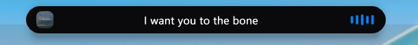
</p>

- **Tương tác**: Di chuột qua để hé mở, giữ trỏ chuột ~0,3 giây (hoặc nhấp chuột) để bung toàn bộ bảng Visor. Cuộn con lăn chuột để chuyển giữa các trang.
- **Khi phát nhạc**: Hiển thị bìa đĩa, thanh tua nhạc, sóng nhạc trực quan (*Cột, Phổ âm, Sóng, Chấm*), dải sáng cực quang theo màu album và **lời bài hát đồng bộ từng câu** (đọc tệp `.lrc` trong `%APPDATA%\BreezeOS\lyrics` hoặc tự tìm qua [LRCLIB](https://lrclib.net)).

<p align="center">
  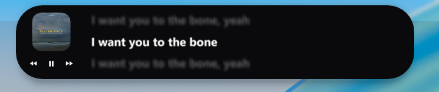
</p>
<p align="center">
  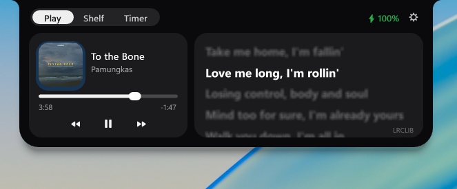
</p>

- **Kệ tệp & Thao tác nhanh**: Kéo tệp thả lên Visor để chọn **Lưu vào Kệ tệp**, **Gửi sang điện thoại** (quét mã QR qua cùng mạng Wi‑Fi cho cả Android & iPhone mà không cần cài thêm app), **Sao chép tới…**, **Mở bằng…** hoặc xử lý ảnh / nén ZIP nhanh.

<p align="center">
  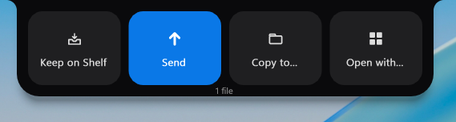
</p>

- **Hẹn giờ, Lịch, Phiên tập trung & Công việc**: Tích hợp đồng hồ đếm ngược, sự kiện Lịch Windows (kèm nút **Tham gia** nhanh trước cuộc họp Meet/Zoom/Teams 10 phút), phiên tập trung Pomodoro và danh sách công việc (`Ctrl + Alt + N` để nhập nhanh như `15:30 họp nhóm`, `10m nghỉ mắt`).
</details>

<details open>
<summary><b>📋 Thanh Rail</b></summary>

- **Menu Logo BreezeOS**: Truy cập nhanh *Giới thiệu về PC này, Cài đặt hệ thống, Microsoft Store, Cài đặt BreezeOS, Lưới ứng dụng, Tổng quan, Buộc thoát, Ngủ, Khởi động lại, Tắt máy, Khóa màn hình, Đăng xuất*. Bạn cũng có thể đổi sang ảnh logo riêng trong *Cài đặt → Rail → Logo thanh Rail*.
- **Menu ứng dụng đang mở**: Tự động hiển thị thanh menu thật của ứng dụng truyền thống hoặc bộ menu thông minh tương ứng cho trình duyệt, File Explorer, bộ Office, trình soạn thảo mã nguồn...
- **Cụm trạng thái bên phải**: Pin (tùy chọn phần trăm bên trong, bên ngoài hoặc ẩn), Wi‑Fi (xem cường độ sóng & kết nối nhanh mạng đã lưu), Tìm kiếm nhanh, Quick Panel và Đồng hồ.
</details>

<details open>
<summary><b>🎚 Bảng điều khiển nhanh (Quick Panel)</b></summary>

- Nhấp vào biểu tượng công tắc kép trên thanh Rail để mở.
- Bật/tắt nhanh **Wi‑Fi**, **Bluetooth** (kết nối tai nghe/loa chỉ với 1 cú nhấp), chỉnh **Độ sáng** (hỗ trợ cả màn hình rời qua DDC/CI hoặc làm dịu bằng phần mềm), **Âm lượng**, chọn thiết bị đầu ra âm thanh, Chế độ tối, Scene, Tổng quan, Chụp màn hình...

<p align="center">
  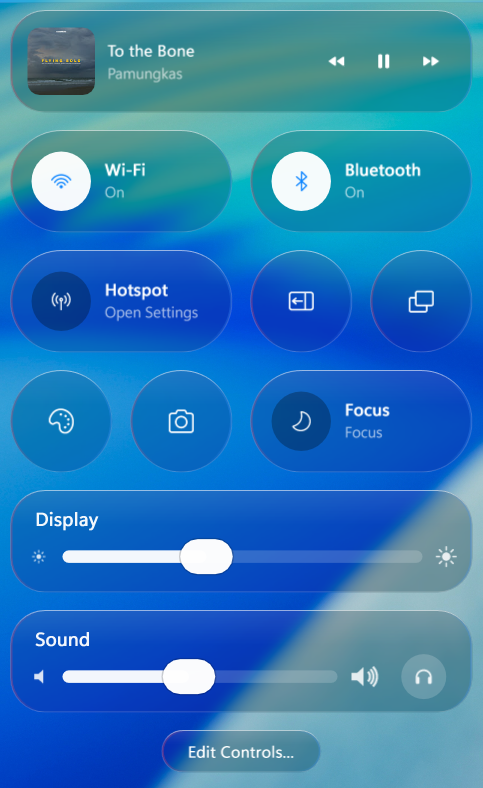
</p>

- **Chỉnh sửa điều khiển…**: Xóa bớt ô bằng nút **−**, kéo để đổi chỗ, nắm **tay cầm kính ở góc** để kéo giãn kích thước từng ô theo chiều ngang/dọc, hoặc thêm điều khiển mới từ thư viện.

<p align="center">
  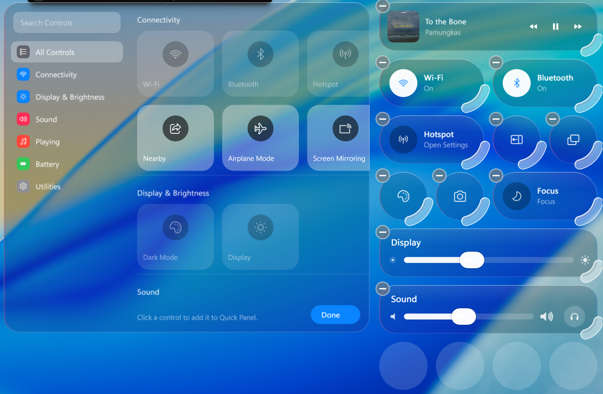
</p>
</details>

<details open>
<summary><b>🧱 Tiện ích màn hình (Widgets)</b></summary>

- Mở thư viện từ *Cài đặt → Tiện ích → Thêm tiện ích* hoặc nhấp chuột phải vào tiện ích trên màn hình → *Chỉnh sửa tiện ích…*.
- Gồm: *Đồng hồ, Giờ thế giới, Hôm nay, Tháng, Đồng hồ số, Pin* và *Theo dõi hệ thống (CPU/RAM)* với hai chất liệu **Nguyên bản (Original)** hoặc **Pha lê (Crystal)** tự bắt dính theo lưới gọn gàng.

<p align="center">
  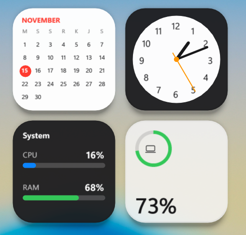
  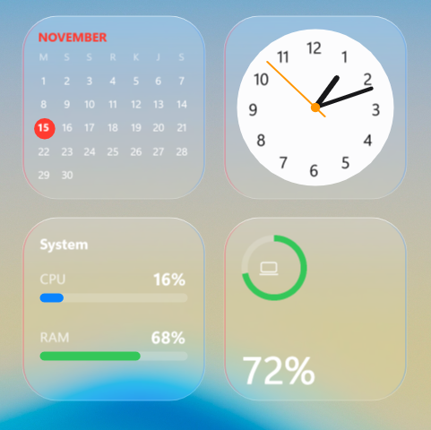
</p>
</details>

<details>
<summary><b>🔍 Tìm kiếm nhanh (Quick Search), 🎬 Scene & 🪟 Tổng quan</b></summary>

- **Tìm kiếm nhanh (`Ctrl + Space`)**: Tìm **Ứng dụng**, **Tệp tin**, **Tác vụ** và **Bộ nhớ tạm** (chuyển nhanh bằng `Ctrl + 1…4`), tích hợp máy tính bỏ túi, tạo mã QR từ bộ nhớ tạm và chấm màu màn hình.

<p align="center">
  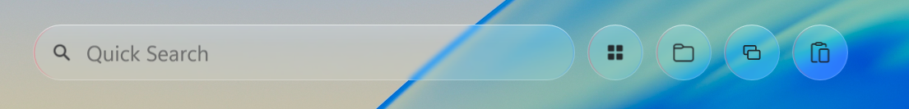
</p>

- **Scene**: Biến các cửa sổ nền thành dải thẻ 3D nghiêng trực quan bên cạnh màn hình; nhấp để đưa cửa sổ ra sân khấu chính, `Shift + nhấp` để gom nhóm cửa sổ.
- **Tổng quan (`Ctrl + ↑`) & Lưới ứng dụng (`Ctrl + Shift + Space`)**: Quan sát toàn bộ cửa sổ đang mở cùng màn hình ảo hoặc duyệt kho ứng dụng theo danh mục.

<p align="center">
  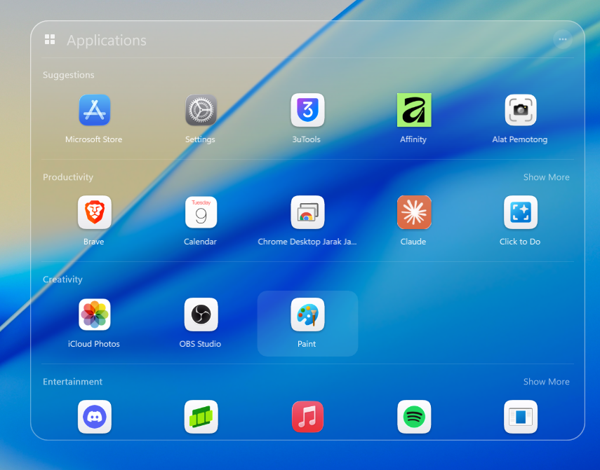
</p>
</details>

### ⌨️ Bảng phím tắt mặc định

| Tổ hợp phím | Chức năng |
|---|---|
| `Ctrl` + `Space` | Mở Tìm kiếm nhanh (Quick Search) |
| `Ctrl` + `Shift` + `Space` | Mở Lưới ứng dụng (App Grid) |
| `Ctrl` + `1` … `4` | Chuyển thẻ trong Tìm kiếm nhanh: *Ứng dụng · Tệp tin · Tác vụ · Bộ nhớ tạm* |
| `Ctrl` + `Alt` + `N` | Thêm nhanh công việc hoặc lời nhắc trên Visor |
| `Ctrl` + `↑` | Mở Tổng quan cửa sổ (Overview) |
| `` Alt` + `` ` `` | Chuyển nhanh giữa các cửa sổ của cùng một ứng dụng |
| `Ctrl` + `Alt` + `H` / `M` / `Q` | Ẩn / Thu nhỏ / Thoát ứng dụng đang hoạt động |
| `Alt` + `Tab` | Bộ chuyển cửa sổ kính của BreezeOS (khi đang bật Scene) |
| `Esc` | Đóng lớp phủ hoặc hộp thoại đang mở |

---

## 🔒 Quyền riêng tư

**BreezeOS tuyệt đối không thu thập, lưu trữ từ xa hay gửi bất kỳ dữ liệu cá nhân nào của bạn.** Không telemetry, không analytics, không quảng cáo, không yêu cầu đăng nhập. Mọi cấu hình đều nằm cục bộ trong `%APPDATA%\BreezeOS`.

- **Lời bài hát trực tuyến**: Chỉ khi bài hát không có tệp `.lrc` cục bộ, BreezeOS mới truy vấn [LRCLIB](https://lrclib.net) bằng tên bài, nghệ sĩ, album và thời lượng (có thể tắt trong *Cài đặt → Visor*).
- **Kiểm tra bản cập nhật**: Định kỳ ~12 giờ/lần đọc danh sách bản phát hành công khai từ `api.github.com` của kho `thanhphong28/BreezeOS-win` (có thể tắt trong *Cài đặt → Chung → Giới thiệu*), và luôn xác thực mã băm SHA‑256 trước khi chạy bộ cài.
- **Gửi sang điện thoại**: Chỉ khởi chạy máy chủ HTTP tạm thời trong **mạng LAN nội bộ** với đường dẫn ngẫu nhiên cho đúng các tệp bạn vừa thả vào, tự tắt khi bấm Hủy, sau 15 phút không hoạt động hoặc khi thoát BreezeOS.
- **Bộ nhớ tạm & bàn phím**: Lịch sử bộ nhớ tạm chỉ giữ trong RAM (chỉ những mục bạn chủ động ghim mới được lưu cục bộ); hook bàn phím chỉ dùng duy nhất để bắt `Alt+Tab` khi bật Scene, tuyệt đối không ghi lại phím gõ.

---

## 🛠 Công nghệ cốt lõi

- **[Rust](https://www.rust-lang.org)** — Toàn bộ ứng dụng được tổ chức thành 5 crate gọn nhẹ, an toàn bộ nhớ.
- **[windows‑rs](https://github.com/microsoft/windows-rs)** — Giao tiếp trực tiếp với hệ thống Win32 và WinRT API.
- **Windows.UI.Composition** — Kết xuất đồ họa kính mờ, hiệu ứng khúc xạ, đổ bóng và chuyển động lò xo trực tiếp trên GPU thông qua một thiết bị đồ họa dùng chung duy nhất.
- **Win32 / WinRT Platform APIs** — WASAPI, System Media Transport Controls, WLAN, Bluetooth, WIC, GDI & OLE Drag-and-Drop.
- **[Inno Setup](https://jrsoftware.org/isinfo.php)** — Đóng gói bộ cài đặt nhỏ gọn cho Windows.
- **Phông chữ đi kèm**: **[Inter](https://rsms.me/inter/)** (SIL Open Font License 1.1) kết hợp Segoe UI Variable dự phòng.

---

## 🏗 Build từ mã nguồn

<details>
<summary><b>Hướng dẫn chi tiết từng bước</b></summary>

### 1. Cài đặt công cụ biên dịch

1. Cài đặt **Rust** qua [rustup](https://rustup.rs) với MSVC toolchain:
   ```powershell
   rustup default stable-x86_64-pc-windows-msvc
   ```
2. Cài đặt **Visual Studio Build Tools** với gói **Desktop development with C++** (bao gồm `link.exe` và Windows 11 SDK).
3. Cài đặt **Git**.

### 2. Sao chép mã nguồn & biên dịch

```powershell
git clone https://github.com/thanhphong28/BreezeOS-win.git
cd BreezeOS-win
cargo build --release
.\target\release\breezeos.exe
```

Sau khi build xong, hai tệp `breezeos.exe` và `breezeos-guard.exe` sẽ nằm tại `target\release\`.

### 3. Chạy kiểm thử & đóng gói bộ cài

```powershell
cargo test --workspace

winget install JRSoftware.InnoSetup                            # chỉ cần cài một lần
powershell -File installer\build-installer.ps1 -Version 1.0.1
```

Kịch bản đóng gói sẽ tự động xóa đường dẫn cục bộ khỏi binary, kiểm tra quyền riêng tư trên tệp `.exe` và xuất ra `dist\BreezeOS-Setup-1.0.1.exe` cùng `dist\BreezeOS-1.0.1-win-x64.zip`.

### 4. Chạy thử nghiệm cô lập an toàn

```powershell
$env:NACRE_CONFIG_DIR = "$PWD\target\cfg-test"
.\target\release\breezeos.exe --keep-taskbar --exit-after 30
```

Các cờ dòng lệnh hữu ích: `--keep-taskbar`, `--no-dock`, `--no-island`, `--no-hud`, `--open-settings`, `--open-widgets`, `--exit-after <giây>`, `--add-app <đường_dẫn>`, `--set-icon <app|start|launchpad> <ảnh>`.

</details>

### Cấu trúc thư mục dự án

| Đường dẫn | Vai trò |
|---|---|
| `crates/core` | Logic thuần có kiểm thử đơn vị (unit tests): trạng thái Visor, lời bài hát, mã QR, bố cục Deck, tiện ích, cài đặt, đa ngôn ngữ (`En`/`Vi`), xử lý biểu tượng |
| `crates/platform` | Lớp giao tiếp Win32 / WinRT: quản lý cửa sổ, media, âm thanh, Wi‑Fi, Bluetooth, tải xuống, WIC, máy chủ gửi tệp nội bộ |
| `crates/ui` | Chất liệu kính mờ trên `Windows.UI.Composition`, thiết bị đồ họa dùng chung và chụp cửa sổ trực tiếp |
| `crates/app` | Ứng dụng chính `breezeos`: Deck, Visor, Rail, Quick Panel, Quick Search, Scene, Widgets, Cài đặt |
| `crates/guard` | Tiến trình bảo vệ `breezeos-guard` tự động khôi phục Taskbar và các cửa sổ đã dịch chuyển nếu ứng dụng dừng đột ngột |
| `assets/` · `installer/` · `tools/` | Logo & phông chữ đi kèm, kịch bản đóng gói Inno Setup / phát hành GitHub Release và công cụ kiểm tra an toàn Taskbar |

---

## ⚙️ Cấu hình & Xử lý sự cố nhanh

Toàn bộ cấu hình được lưu dưới dạng văn bản thuần tại `%APPDATA%\BreezeOS\` (`settings.cfg`, `pins.txt`, `icons.txt`, `cc_layout.txt`, `widgets.txt`, `actions.txt`, `todo.txt`, `lyrics\` và `breezeos.log`).

- **Mất thanh Taskbar sau sự cố hiếm gặp**: Mở lại `breezeos.exe` rồi chọn *Thoát BreezeOS*, hoặc chạy `breezeos-guard.exe` để khôi phục ngay.
- **Điện thoại không mở được liên kết QR gửi tệp**: Đảm bảo máy tính và điện thoại kết nối **cùng một mạng Wi‑Fi**, đồng thời cho phép BreezeOS đi qua Windows Firewall ở mạng Riêng tư (*Private networks*).
- **Menu Wi‑Fi chỉ hiện các mạng đã lưu**: Windows yêu cầu cấp quyền *Vị trí (Location)* cho ứng dụng để quét danh sách Wi‑Fi xung quanh (BreezeOS không bao giờ đọc hay lưu vị trí của bạn).
- **Phím tắt không phản hồi**: Một phần mềm khác trên máy đang chiếm dụng tổ hợp phím đó (kiểm tra chi tiết trong `breezeos.log`).

---

## 👤 Tác giả & Giấy phép

- **Phát triển & Duy trì**: **Nguyễn Thanh Phong (Breeze Boy)** — [@thanhphong28](https://github.com/thanhphong28)
- **Kho mã nguồn chính thức**: [github.com/thanhphong28/BreezeOS-win](https://github.com/thanhphong28/BreezeOS-win)
- **Giấy phép**: Phát hành theo [PolyForm Noncommercial License 1.0.0](LICENSE.md) — cho phép sử dụng, nghiên cứu, tùy biến và chia sẻ cho các mục đích **phi thương mại**. Phông chữ **Inter** đi kèm thuộc bản quyền © The Inter Project Authors theo giấy phép SIL Open Font License 1.1 (`assets/fonts/Inter-LICENSE.txt`).

Copyright © 2026 Nguyễn Thanh Phong (Breeze Boy).
